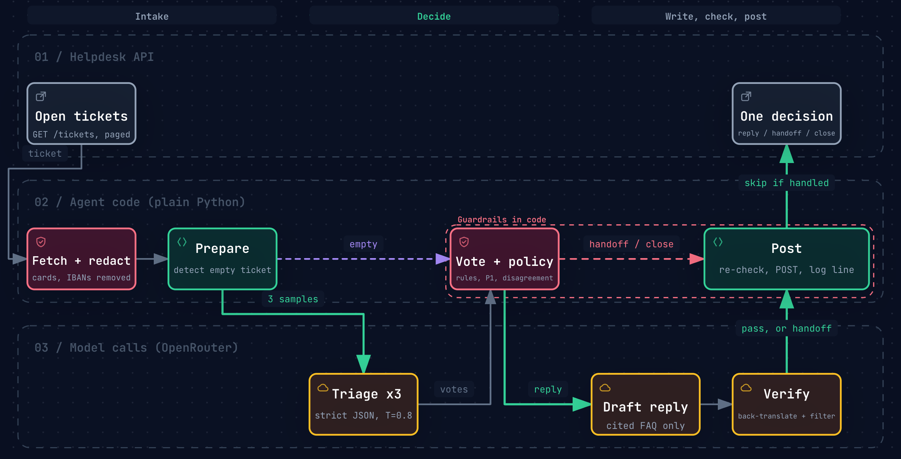

# Roosterly support agent

The agent reads every open ticket from the Roosterly helpdesk and posts one decision per ticket: a reply
drafted from the help centre (`faq.md`), a handoff to the support team with a note in English, or a close
for spam and empty tickets.

## How to run

You need Python 3.12+ and [uv](https://docs.astral.sh/uv/).

```bash
uv sync && cp .env.example .env      # then fill in the keys
uv run python safety.py && uv run python test_reliability.py   # offline checks, no network
uv run eval.py --tag mine --runs 3   # eval on the 10 labelled examples, posts nothing
uv run agent.py --dry-run            # decide every open ticket and print, post nothing
uv run agent.py --reset              # final run: reset the practice set, then handle all 30 once
uv run ui.py                         # optional walkthrough + live demo at http://127.0.0.1:8000
```

`.env.example` lists the variables: the helpdesk URL and key, the candidate email, the OpenRouter key and the
model (`openai/gpt-6-luna`). Re-running `agent.py` is safe because tickets that are already handled are
skipped, and `--only T005 T007` handles specific tickets. Every run writes one line per ticket to
`logs/agent.jsonl`; eval results go to `eval/results/`.

## Decisions



1. **A fixed LangGraph pipeline instead of a tool-calling agent.** Every ticket goes through the same steps,
   `prepare → triage → policy → draft → verify → post` (`graph.py`). The steps never change, so letting the
   model choose tools in a loop would only add ways to go wrong. The model makes narrow judgements into strict
   JSON schemas (language, category, priority, which FAQ sections answer the ticket, which client rules
   apply), and plain Python makes the decision from them. LangGraph gives a checkpoint after every step and
   retries on the model calls. LangChain is only the model client (`ChatOpenRouter` with structured output).
2. **Code can only move a ticket towards a human.** After triage, a policy step in plain code checks the
   model's answer. A ticket goes to a human when any of the three triage samples flags a client rule (refund
   or disputed charge, cancellation or contract change, GDPR/AVG request, security incident, legal threat,
   churn threat), when a Dutch, English or German keyword for one of those rules matches, when the ticket is
   P1, when the samples disagree on the action, when a reply would cite no FAQ section, or when confidence is
   below 0.7. A rule hit also raises the priority to at least P2. I measure "unsure" by asking the same triage
   question three times at temperature 0.8; if the answers disagree on the action, a human gets the ticket.
   Ticket text is wrapped in tags and treated as data, and the draft only sees the FAQ sections the triage
   cited, so the injection attempts in T007 and T030 changed nothing.
3. **Dutch is handled directly and checked in English.** The model reads and writes Dutch itself.
   Translating every ticket first would add a model call per ticket and lose the tone and the Dutch menu
   names customers see in the app. To check a reply without reading Dutch, a second model call
   back-translates the draft into English, identifies its language, and lists any claim the cited FAQ
   sections do not support and any promise. Code then checks the links (only domains the FAQ names), email
   addresses and payment details. Any problem turns the reply into a handoff. The English version is logged
   as `reply_en`, so a reviewer only has to read English.

Where the brief was open, I assumed that how-to questions about self-service changes, such as upgrading the
plan (F05), get a reply instead of a contract-change handoff. Feature requests get a reply pointing to the
roadmap, as in example E05. A ticket with several issues goes to a human if any of them needs one.

I built this with Claude Code and used it for research (agent frameworks, how production support agents are
run), writing code, debugging and running tests. I chose the framework, the uncertainty method and the
escalation policy, and I reviewed the dry-run decisions before the final run.

## Reliability

- 429: the client throttles itself to 4 calls a second, under the limit of 5. If a 429 still comes back, it
  waits the `Retry-After` seconds and tries again.
- 503 and network errors are retried with exponential backoff plus jitter, up to 8 tries. Other 4xx errors
  (400, 401, 404, 422) mean the request itself is wrong, so they are not retried.
- 409, and never answering twice: before every POST the agent fetches the ticket again and skips it if it is
  already handled. If a POST was saved but its response got lost, the retry gets a 409, which counts as done.
  Two agents running at once against the same tickets gave zero double answers.
- Crash: each ticket is a LangGraph thread checkpointed in `checkpoints.db`, and the next run continues at
  the step where it stopped (tested with `kill -9`). A failed model call leaves that ticket open while the
  run carries on with the others. In the final run, T001 to T005 resumed from an earlier attempt that had
  failed on an expired API key.
- Security: keys come only from environment variables in `.env`, which is git-ignored. Card numbers
  (Luhn-checked), IBANs (mod-97), CVCs and expiry dates are redacted before ticket text enters the graph, so
  the model, the checkpoints and the logs never see them, and everything posted is redacted again.
  `test_reliability.py` tests the error handling offline with scripted responses, and `safety.py` has a
  self-check for the redaction and keyword rules.

## Eval and fix

`eval.py` runs the whole graph on the 10 labelled examples from `GET /examples`, without posting, and
compares the result with Nordavo's labels. The model never writes or sees the labels. Each eval runs 3 times,
because sampling makes a single run noisy.

| | unsafe* | over-escalated | action | category | priority | language |
|---|---|---|---|---|---|---|
| baseline | 0 | 7/30 | 0.77 | 0.97 | 0.80 | 1.00 |
| after fix | 0 | 2/30 | 0.93 | 1.00 | 0.80 | 1.00 |
| final code | 0 | 1/30 | 0.97 | 1.00 | 0.80 | 1.00 |

\*Unsafe means the label says handoff but the agent replied or closed. Over-escalated means the label says
reply but the agent handed off.

In the baseline the agent handed off tickets the help centre does answer, when that answer is a requirement
or a pointer. E01 reports a crash on iOS 15, and F12 says the app needs iOS 16 or later. E10 asks about
maintenance tonight, and F11 points to the status page. The agent also read E02 (changing the VAT number on
invoices) as a contract change.

The fix: the triage prompt now defines what counts as an answer (steps, facts, a requirement that explains
the problem, or the resource to check), the cancellation flag covers only contract terms, and the reply
checker accepts a pointer to a resource. Over-escalation dropped from 7/30 to 2/30 with no unsafe decisions,
and a 30-ticket dry run afterwards gave no client-rule ticket a reply. The final code, with the P1 rule and
the reply filter added, scores 1/30. Priority stays at 0.80: the agent tends to say P2 where the label says P3.

Cost: the final 30-ticket run cost $0.0126, about $0.04 per 100 tickets, measured from OpenRouter's per-call
cost. Triage is 3 calls per ticket, each about 1.9k input tokens (98% cached, $0.01 per million) and 140
output tokens ($0.50 per million), so roughly $0.00009 a call. A reply adds a draft and a check call, about
$0.0003. At 200 tickets a week that is under $5 a year.

## What I would improve

My next step would be drafts approved by a person: a LangGraph `interrupt()` before posting, so the support
team approves replies first, then auto-send one category at a time, with a kill switch. After that:

- Keep customer data in the EU, as F09 promises: an EU endpoint with zero data retention, pseudonymised
  names, limits on log retention and a DPIA.
- Add an AI disclosure to replies (EU AI Act article 50).
- Have the support team label about 100 real tickets, add a set of adversarial tickets, and run the eval in
  CI. Priority is the weakest field.

One change to the client's rules: define "contract changes". Read literally it includes upgrading, which F05
tells customers to do themselves, so a strict reading sends simple how-to questions to a human.
